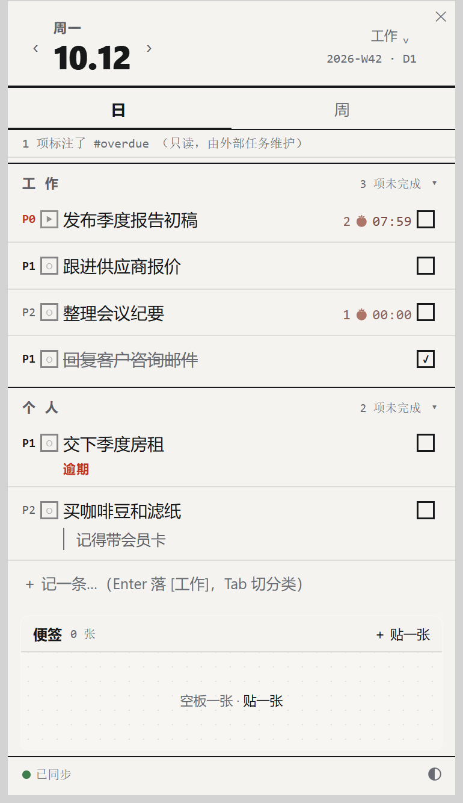

# 日課 (rike)

**English**: rike is a Windows desktop sticky to-do widget — day/week linked views, automatic rollover of unfinished tasks, future-date scheduling, a pomodoro timer per task, an embedded sticky board with a zoomable A4 note editor, edge auto-hide, in-app self-update, and multi-PC sync through your own Git repository. Built with Tauri 2 + Rust + TypeScript. No backend, no accounts: your tasks live as plain markdown files in a repo you own.

Windows 桌面常驻待办贴纸：小窗口贴在桌面一角，日 / 周视图联动，未完成任务跨日自动流转，任务级番茄钟计时，多台电脑通过你自己的 Git 仓库同步。当前版本 **0.10.2**。



## 功能

- **桌面常驻贴纸**：按住报头拖动，靠近屏幕边缘自动吸附，位置本机记忆；贴住左 / 右屏幕边缘自动隐藏只留 4px 细边，鼠标移近即唤出；Alt+S 唤起，Esc 或 5 秒无操作沉回桌面层；长清单自动限高可滚动。
- **多笔记本**：点击顶部名称切换、新建或重命名；各笔记本的任务与历史遗留独立保存。
- **日 / 周联动**：日事项自动显示在所属周，日 / 周操作共用同一份任务状态；周视图标出事项来源日期。
- **未来日期预排**：点报头日期跳到任意日期排任务——事项留在所属日期不提前进今天；到期即当天文件，过期未完成自动流转到今天。
- **未完成自动流转**：昨天日任务未勾选自动搬入今天，勾掉即消失，不再手动誊写。
- **任务管理**：优先级 P0–P3 恒定排序显示、完成项全局沉底；工作 / 个人分类、右键标记 `#doing` / `#blocked`（可附原因）、`#overdue` 只读展示；输入 Enter 保存、Esc 取消、Tab 切分类。
- **任务状态与番茄钟**：每条任务一个状态钮——开始一段 25 分钟番茄（开始后不可暂停），到点勾选完成时自动结算 +1；任务行右侧三件套显示累计番茄数、番茄图标与当前段 MM:SS（开始过才显示）；多任务可并行计时，窗口隐藏仍按到期结算；旧秒表数据自动折算并入（`#t` 秒数 ÷ 1500）；落盘为 `#pomo` / `#ts` 标签，行尾勾选框完成 / 取消完成（恢复闲置、保留番茄数）。
- **多行任务**：添加 / 编辑时 Shift+回车换行，落盘为两空格缩进的子行。
- **优先级调档不跳位**：调整优先级期间显示序冻结（行原地换档），停止调整 1.5 秒后重排。
- **正文字号五档**：12–16px 五档缩放，设置里 A− / A⁺ 即时生效，仅保存在本机。
- **2 款主题**：毛玻璃（Windows 亚克力透桌面，默认）、极简黑标；已移除主题的旧存档自动回退默认主题，选择仅保存在本机。
- **便签板**：主窗口内嵌便签板，便签按笔记本 × 日期离散落盘、随 Git 同步；卡片点开即改、撕掉可撤销、四色纸面相邻不重色；⤢ 放大为独立 A4 浮窗撰写（见下）。
- **Git 同步**：本地编辑立即落盘为 markdown（`days/*.md`、`weeks/*.md`、`stickies/**/*.md`）；30 分钟自动同步、可点页脚立即同步、退出时本地 commit 保底；多机并发靠 commit → pull --rebase → push 收敛，冲突走语义自动合并（任务块级三方合并，`_current.md` 派生视图取对端，其余文本行级并集）。
- **单实例**：同一台电脑同时只允许打开一个实例；报头 ✕ 关闭应用。
- **自动更新**（Windows）：每次启动自动检查本仓库 GitHub Releases，有新版即下载、SHA-256 校验后换入重启；外观面板显示当前版本与更新状态；公开仓库无需任何令牌，更新失败不影响当前版本运行。

## 便签板

主窗口内嵌便签板：便签按笔记本 × 日期离散落盘，随既有 Git 日文件同步；卡片点开即改，撕掉可撤销，四色纸面相邻不重色。

- 编辑器首行是标题行：标题输入与右上角 ⤢ 同处一行，标题加粗，回车跳正文；正文首行即卡片标题。
- 点 ⤢ 放大：便签在屏幕中央展开为独立 A4 浮窗，报头可拖动、右下角可拉角改尺寸；工具面板留在屏幕右侧原位，点主窗口不会收回便签。
- 再点 ⤢ 或按 Esc 收回，未保存的文字原样带回行内编辑器；Ctrl+Enter 保存。
- 加固：放大窗异常关闭或失去应答时，主窗口 3 秒看门狗用最近内容兜底还原，不会卡死在放大状态。

## 近期迭代

- **0.9.0** 便签板上线：主窗口内嵌便签板，每日离散卡片存储，撕掉撤销。
- **0.9.1** 便签 A4 放大编辑初版与主题界面修正。
- **0.9.2** 便签输入重构，玻璃面板半透化。
- **0.9.3** 便签交互修正与独立 A4 浮窗；移除午夜墨蓝、雾蓝点阵主题（旧存档自动回退默认主题）。
- **0.9.5** macOS（Apple Silicon）适配：⌘⌥S 唤起 / Esc・5 秒自动隐藏 / 位置记忆 / 开机自启；Windows 行为零变化（公开仓 Releases 暂只分发 Windows 构建）。
- **0.9.6** 便签视觉收敛：编辑器提示条去分界线；便签放大后主窗收回默认高度；展开态滚动条隐藏；毛玻璃主题下展开便签纸改不透明纸面。修复仅关主窗而便签浮窗仍存活时的进程残留。
- **0.9.7** 计时模块改为番茄钟：25 分钟一段、开始后不可暂停；任务行右侧三件套（累计数 + 莫兰迪陶土色番茄图标 + MM:SS），开始过才显示；多任务并行计时，窗口隐藏仍结算；旧秒表数据自动折算并入。同步按增量合并双端番茄数；修复双机同日各自新建日 / 周文件时对端任务被错挂备注段、导致次日不流转的问题。
- **0.10.0** 吸边自动隐藏 + 应用内自动更新：主面板贴左 / 右屏幕边缘自动滑出只留细边，鼠标移近唤出、移开再隐（`STICKY_EDGE_HIDE=0` 可关）；每次启动自动检查本仓库 Releases，下载校验后换入重启，全程失败不砖机。
- **0.10.1** 便签板向真实便签对齐：① 便签永续——便签板改为当前笔记本**全部日期合并**展示，不再随任务区浏览日变动，贴上后一直在板上，撕掉（删除，3 秒撤销照旧）才消失；旧数据零迁移直接兼容。② 手写体日期——每张便签右下角显示创建日期（如 `2026.10.12`，由便签 ID 派生），替代原 HH:MM 时间显示；内联编辑器与 A4 放大纸面同步显示。
- **0.10.2** 版本与更新融入底栏：外观面板回归纯主题 + 字号；版本号与更新短状态（检查中 / 下载中 / 待重启 / 更新失败）同格叠放在底部状态栏，点开小面板显示完整状态、手动「检查更新」与更新令牌输入；Esc 或点击面板外关闭；触屏窄窗走右列 44px 按钮布局。

## 安装（Windows 10/11）

从 [Releases](https://github.com/FiroYu/rike/releases) 下载：

| 文件 | 说明 |
| --- | --- |
| `rike-0.10.2-x64-setup.exe` | NSIS 安装包（推荐） |
| `app.exe` | 便携版，下载后直接运行（自动更新也使用该文件） |

0.10.0 起支持应用内自动更新：升级到本版本后，后续新版本由应用启动时自动检查并完成升级（`app.exe.sha256` 为更新校验文件）。

依赖 WebView2（Windows 11 自带；Windows 10 缺失时安装包会自动处理）。

## 同步配置（必读）

日課不经过任何第三方服务，任务数据完全存在**你自己的** Git 仓库里：

1. 在 GitHub 新建一个**私有空仓库**（例如 `sticky-sync`）。
2. 首次启动日課，点页脚「**同步设置**」：
   - 仓库地址填 `https://github.com/<你的账号>/<仓库名>`；
   - PAT 填一个只含 `repo` 权限的 [fine-grained token](https://github.com/settings/personal-access-tokens)。
3. 多台电脑填**同一个仓库**，任务自动互通。每台机器的提交身份默认取计算机名，也可用环境变量 `STICKY_MACHINE_TAG` 或 `%APPDATA%\sticky-todo\machine.txt` 自定义（页脚右下角可见，如 `sticky@office:`）。

> 不配置时同步会一直报错（默认地址是占位符）——先完成上面两步即可。仓库地址也可在启动前用环境变量 `STICKY_REPO_URL` 指定；克隆位置默认 `%LOCALAPPDATA%\sticky\sticky-sync`，可用 `STICKY_REPO_DIR` 覆盖。

## 构建

技术栈：Tauri 2 + WebView2 + Vanilla TypeScript + Rust。

```powershell
npm ci
npm run build
cargo build --manifest-path src-tauri/Cargo.toml --release --features custom-protocol
# 或同时生成 Windows NSIS 安装包
npm run tauri -- build --bundles nsis
```

直接运行 cargo 产物时必须带 `--features custom-protocol`，否则程序会去加载开发服务器。

## 开发与验证

```powershell
cargo test --manifest-path src-tauri/Cargo.toml
cargo clippy --manifest-path src-tauri/Cargo.toml -- -D warnings
npm run build
```

CI（`.github/workflows/windows.yml`）在 push 时运行同样的检查并产出 NSIS 安装包。

## License

[MIT](LICENSE)
